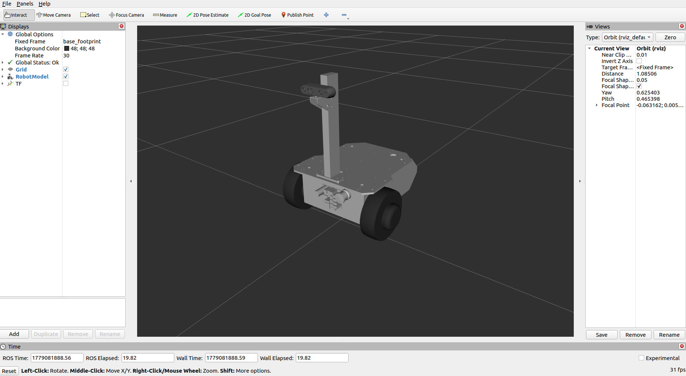
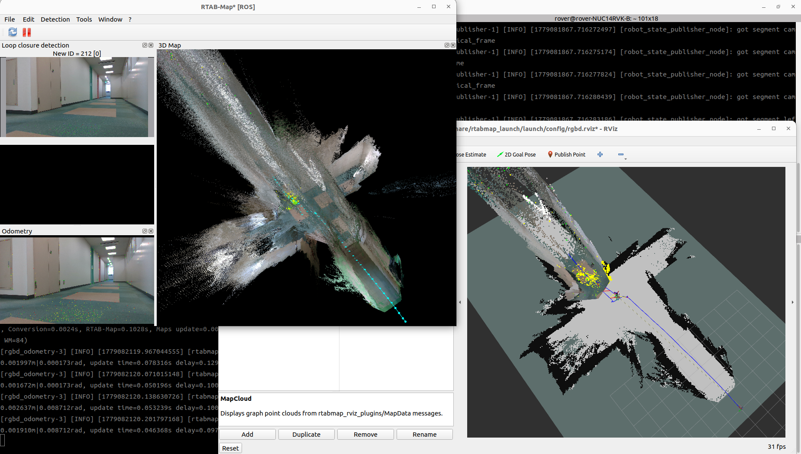
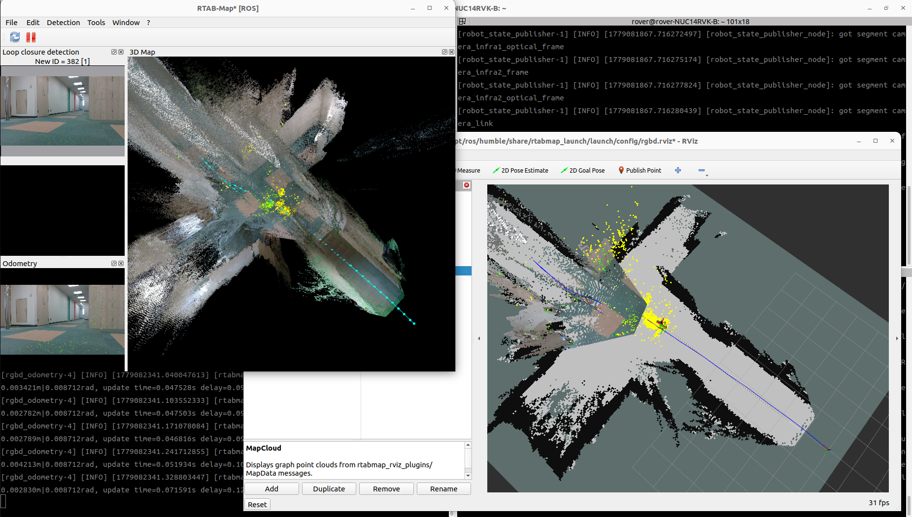

# vs_rover_depthcam_samplesについて
本パッケージは、研究開発用大型台車のオプションである、デプスカメラオプション用のROS2サンプルパッケージです。  

デプスカメラオプションの詳細については、[製品ページ](https://www.vstone.co.jp/products/wheelrobot/rover_option.html)をご覧ください。

## 使用方法

詳しい使用方法はデプスカメラオプションの取扱説明書をご確認ください。  
取扱説明書は、各大型台車用SDKのダウンロードページ下部にございます。

---

## セットアップ

### RealSenseのセットアップ

以下では、Ubuntu環境でROS2 Humbleを用いてRealSenseを活用する場合のセットアップ方法について記述します。  
Windowsや、その他環境でRealSense SDKを用いられる場合は、インテル社の取扱説明書やwebページの情報を参考にセットアップを行ってください。

> 記載の手順は、2026年5月18日時点で下記GithubページにおいてインテルRealSense社から案内されている情報を簡単にまとめたものです。より詳しい情報や最新の情報については、下記のGithubページをご確認ください。  
> IntelRealSense/realsense_ros : https://github.com/realsenseai/realsense-ros

#### Intel RealSense SDK のインストール

以下のコマンドを実行し、librealsense2をインストールします。

1．サーバの公開鍵を登録する

```bash
sudo mkdir -p /etc/apt/keyrings
curl -sSf https://librealsense.realsenseai.com/Debian/librealsenseai.asc | \
gpg --dearmor | sudo tee /etc/apt/keyrings/librealsenseai.gpg > /dev/null
```

2．リポジトリリストにサーバーを追加する

```bash
echo "deb [signed-by=/etc/apt/keyrings/librealsenseai.gpg] https://librealsense.realsenseai.com/Debian/apt-repo `lsb_release -cs` main" | \
sudo tee /etc/apt/sources.list.d/librealsense.list
sudo apt-get update
```

3．ライブラリをインストールする

```bash
sudo apt-get install librealsense2-dkms librealsense2-utils librealsense2-dev librealsense2-dbg
```

4．インストールを確認する

RealSenseの取扱説明書に従いカメラをPCのUSB3.0に接続し、以下コマンドでインストールを確認してください。

```bash
realsense-viewer
```

#### realsense-ros のインストール

以下のコマンドを実行し、realsense-rosをインストールします。

1．ROS2ワークスペースを作成する

```bash
mkdir -p ~/ros2_ws/src
cd ~/ros2_ws/src/
```

2．realsense-rosをクローンする

```bash
git clone https://github.com/realsenseai/realsense-ros.git -b ros2-master
cd ~/ros2_ws
```

3．依存関係をインストールする

```bash
sudo apt-get install python3-rosdep -y
sudo rosdep init
rosdep update
rosdep install -i --from-path src --rosdistro humble --skip-keys=librealsense2 -y
```

4．パッケージのビルドを実行する

```bash
colcon build --symlink-install
```

---

### vs_rover_depthcam_samples のセットアップ

#### 依存パッケージのインストール

以下のコマンドで依存パッケージをインストールします。

```bash
# rtabmap
sudo apt install ros-humble-rtabmap-ros

# Navigation2
sudo apt install ros-humble-navigation2
sudo apt install ros-humble-nav2-bringup
sudo apt install ros-humble-nav2-rviz-plugins

# imu_filter_madgwick
sudo apt install ros-humble-imu-filter-madgwick

# depthimage_to_laserscan
sudo apt install ros-humble-depthimage-to-laserscan
```

#### vs_rover_depthcam_samples のインストール

1．端末を開き、ROS2ワークスペースのsrcフォルダに移動する

```bash
cd ~/ros2_ws/src
```

2．vs_rover_depthcam_samplesパッケージをダウンロードする

```bash
git clone -b humble https://github.com/vstoneofficial/vs_rover_depthcam_samples.git
```

3．ROS2ワークスペースのrootディレクトリに移動する

```bash
cd ~/ros2_ws
```

4．パッケージのビルドを実行する

```bash
colcon build --symlink-install
```

5．端末を再起動する

---

## サンプル使用方法

vs_rover_depthcam_samplesパッケージを使用してSLAM・自律走行を行う手順について記載します。下記手順ではメガローバーVer.3.0を例にしています。
> **事前準備:** 各ローバーのROS2パッケージをあらかじめセットアップしておいてください。

### SLAMの実施方法

各ステップは別々の端末で実行してください。

1．ROS2とMicro-ROSを統合するためのエージェントノードを起動

```bash
sudo chmod 666 /dev/ttyUSB0
ros2 run micro_ros_agent micro_ros_agent serial --dev /dev/ttyUSB0 --baudrate 921600 -v4
```

2．ロボットの3Dモデルの表示（3Dモデルのカメラオプションを有効化）

```bash
ros2 launch vs_rover_depthcam_samples depthcam_robot.launch.py rover:=mega rover_choice:=mega3
```

- depthcam_robot.launch.pyで設定できるパラメータは以下の通りです。

| パラメータ名 | デフォルト値 | 説明 |
|:---:|:---:|:---|
| `rover` | `mega` | 使用するローバーの種類。`mega` / `mecanum` / `fwds` から選択 |
| `rover_choice` | 自動 | `rover` の種類に応じたモデルを指定。省略時は各roverのデフォルト値が使用されます |

`rover_choice` の選択肢はローバーの種類によって異なります。

| `rover` | `rover_choice` の選択肢 | デフォルト |
|:---:|:---|:---:|
| `mega` | `mega3` / `f120a` / `s40a_lb` | `mega3` |
| `mecanum` | `mecanum3` / `g120a` / `g40a_lb` | `mecanum3` |
| `fwds` | `x40a` / `x120a` | `x40a` |



3．RTAB-MapとRealSenseを起動する（マップ作成モード）

```bash
ros2 launch vs_rover_depthcam_samples rs_camera_rtabmap.launch.py 
```

- rs_camera_rtabmap.launch.pyで設定できる代表となるパラメータは以下の通りです。

| パラメータ名 | デフォルト値 | 説明 |
|:---:|:---:|:---|
| `localization` | `false` | `true`: 自己位置推定モード / `false`: マップ作成モード |
| `rtabmap_viz` | `true` | RTAB-Map GUIの起動 （`true`:表示 `false`:非表示）|
| `rviz` | `true` | rviz2の起動 （`true`:表示 `false`:非表示）|



- 画像のようにRTAB-Map[ROS]とrviz2が起動したら、ローバーをゆっくりと走行させ、rviz上に地図が出来上がっていくことを確認してください。
- 地図が完成したらRTAB-Map[ROS]にある一時停止ボタンを押すことで、地図の作成を中断することができます。
- rs_camera_rtabmap.launchを起動した端末で`Ctrl+C`を押すことで、マップを自動保存して終了することができます。

### 自律走行の実施方法

各ステップは別々の端末で実行してください。

1．ROS2とMicro-ROSを統合するためのエージェントノードを起動（SLAMの実施方法 手順1.と同様）

2．ローバーの3Dモデルの表示（SLAMの実施方法 手順2.と同様）

- 安全のため、VS-C3でいつでも操縦可能な状態にしてください。
- VS-C3の入力が最優先で処理されますので、壁等にぶつかりそうな場合は、VS-C3の操作で動作を変更することが可能です。

3．RTAB-MapとRealSenseを起動する（自己位置推定モード）

```bash
ros2 launch vs_rover_depthcam_samples rs_camera_rtabmap.launch.py localization:=true
```



- RTAB-Map[ROS]とrviz2が起動したら、RTAB-Mapが自己位置推定できていることを確認してください。自己位置推定ができている場合は、rviz2の地図上にローバーの位置が表示されます。
- 自己位置推定ができていない場合や、表示されている位置が実際と異なる場合は、VS-C3等でローバーを走行させ、自己位置推定ができる場所に移動させてください。

4．Navigation2を起動する

```bash
ros2 launch vs_rover_depthcam_samples navigation.launch.py
```

- rviz2の「2D Nav Goal」ボタンを使って、地図上に目標位置と姿勢を設定します。ローバーが走行を開始することを確認してください。
- 走行を終了する場合は、rs_camera_rtabmap.launchを起動したシェルで`Ctrl+C`を押してください。

---

### パラメータの適用
自律走行において、ローバーの挙動を様々なパラメータで調整することが可能です。使用するローバーや環境に適していないパラメータで実行すると、うまく走行できないことがあります。navigation.launchでは、roverパラメータの設定で呼び出すパラメータファイルを変更することができるようになっており、標準では次の3種類に対応しています。

| ローバーの種類 | パラメータ |
|:-----:|:-----:|
| メガローバー用 |mega |
| メカナムローバー用 |mecanum |
| 4WDSローバー用 |fwds |

コマンドの例
```bash
ros2 launch vs_rover_depthcam_samples navigation.launch.py rover:=mega
```

それぞれで呼び出されるパラメータファイルは、vs_rover_depthcam_samplesの`config`以下にあります。各パラメータの詳細については、ファイルおよびNavigation2の公式ドキュメントをご覧ください。

RNavigation2 Document : https://docs.nav2.org/

なお、デフォルトではカメラの取付位置をローバー前方に真っすぐ、水平角度で取り付けた場合のパラメータが設定されています。実際の取り付け位置に合わせて、適宜3Dモデルの値を変更してください。

---

# 更新履歴

### 1.0.0
初版
